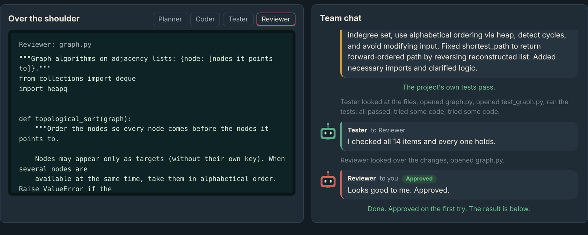

# Relay: a team of four AI agents

Ask for anything (a study plan, a speech, a web page, a bug fix) and four AI agents work it
out together: a **Planner** writes a checklist, a **Builder** makes the thing, a **Checker**
verifies every item, and a **Reviewer** approves it or sends it back. You watch it happen in
a little night-shift office, where each robot's screen shows what it is actually doing.


<sub>A real recorded run, sped up: fixing a graph library with 14 requirements.</sub>

## The robots talk to each other

Each robot finishes by handing over its work plus a short note to the next robot, written in
its own words. The note becomes part of the next robot's instructions. The team chat shows
these notes and, underneath, what each robot did ("opened graph.py, ran the tests").



## The crew


Every robot runs the same model with its own job description, its own tools, and a typed
`submit_*` tool whose arguments are validated by pydantic, so robots pass structured data
(a checklist with IDs, a pass/fail report with evidence) rather than prose. Only the Builder
can change files, and the tool layer enforces that a second time.

## Does a team beat one agent?

Measured on 15 bug-fixing tasks with hidden tests, 3 runs each, with the same model
(`gpt-oss-120b`) and code for both modes.


| | One agent | Team of four |
|---|---|---|
| Passed | 41 / 44 (93%) | **44 / 44 (100%)** |
| Tokens per task | 11,459 | 47,932 (4.2x) |
| Time per task | 11.1 s | 28.4 s (2.6x) |

What the traces show:

- **The whole difference is one task.** The single agent fixed what the visible tests showed
  and missed a rule written only in a docstring (`min_coins` returns -1), in all three runs.
  The Planner wrote that rule down as a requirement, and the Coder then handled it every time.
- **The revision loop never fired.** Every team run passed on the first round; the Tester
  never reported a failure and the Reviewer approved everything. On this benchmark, the
  checkers added cost but changed no outcome.
- **The Tester often ran out of steps** (64% of runs) because it checked one item per step.
  It now batches checks; this change has not been measured yet.

Full analysis, corrections, and limitations: [evals/RESULTS.md](evals/RESULTS.md).

## How it works

```mermaid
flowchart LR
    T[Request] --> P[Planner]
    P -->|checklist + note| C[Builder / Coder]
    C --> G{Project's own tests\n(no AI)}
    G -->|fail| C
    G -->|pass| TE[Checker / Tester]
    TE -->|an item fails| C
    TE -->|all pass + note| R[Reviewer]
    R -->|blocker issues| C
    R -->|approve| D[Done]
```

- **One agent loop, four configurations.** Rate-limit handling, context compaction, loop
  detection, and tracing are written once and shared by every role.
- **Cheap checks first.** A deterministic test run sits between the Builder and the Checker,
  and the Reviewer only runs once every item passes.
- **Two kinds of work.** *Fix* repairs an existing project; *create* makes something new from a
  request, and the Checker measures anything countable (word counts, sections) with code.
- **Built to survive free tiers.** Waits on rate limits, stops cleanly at daily limits, keeps
  each request under a size budget, retries malformed tool calls with an explanation, and
  enforces per-job token budgets.
- **Observable.** Every agent writes a JSONL trace and every team run saves its full state.

Design notes and the reasoning behind each decision: [docs/ARCHITECTURE.md](docs/ARCHITECTURE.md).

## Safe to put on the internet

The web app has a public mode (`RELAY_PUBLIC=1`) so anyone can use it without an account or
a key:

- The server's key is read once at start-up and removed from the environment, and the server
  process is made non-dumpable, so code the agents run cannot read it.
- Model-written code runs in a guarded sandbox: Python audit hooks block network access,
  starting programs, native libraries, reading `/proc` and the app's own files, and writing
  outside the job's folder; a zero process limit stops even low-level forks; memory, file
  size, and CPU time are capped. (`SANDBOX=docker` gives a full container instead.)
- A daily token allowance for the whole site and a few jobs per visitor per day. With a key
  from a provider account that has no payment method, the site cannot cost money: when the
  free quota runs out, it says so and offers the recordings.
- Nothing a visitor types is kept after their job ends.

## Run it

```powershell
git clone https://github.com/Muhammad-Aitzaz-Khan/agent-orchestrator.git
cd agent-orchestrator
python -m venv .venv
.venv\Scripts\activate
pip install -e ".[dev]"
copy .env.example .env      # add a key for any OpenAI-compatible provider (Groq has a free tier)
python -m orchestrator.doctor
python -m orchestrator.web  # opens the office in your browser
```

The recorded jobs play without a key. Other entry points:

```powershell
python evals/run_evals.py --mode multi --repeats 3     # the benchmark (also: single, plan-code)
python -m orchestrator --mode multi --root path\to\project "Fix the failing tests."
```

### Put your own copy online (Hugging Face Spaces, free)

1. `python deploy/build_space.py` writes `dist/space/`.
2. On huggingface.co, create a new Space with the **Docker** SDK and upload everything inside
   `dist/space/`.
3. In the Space's settings, add a secret named `GROQ_API_KEY`.

## Evaluation harness

`evals/` holds 15 tasks (easy to hard) with visible tests, hidden tests that only check
behaviour the docstrings specify, and reference solutions. The harness copies each task to a
temporary folder, runs an agent, restores the original tests, adds the hidden tests, and
judges by running pytest itself. Results are saved after every run, API errors are excluded
from scores, and interrupted runs resume with `--retry-errors`. Details:
[evals/README.md](evals/README.md).

## Project layout

```
src/orchestrator/
    agent.py          the agent loop and its recovery logic
    roles.py          the four roles, for fixing and for creating
    orchestrator.py   the state machine that coordinates them
    tools.py          tools, permissions, and sandboxes
    guard/            the audit-hook sandbox used on servers without Docker
    context.py        keeps requests under a size budget
    doctor.py         checks the provider, key, and model
    web/              the office (one HTML page), live events, public mode, recordings
evals/                benchmark tasks, harness, re-scoring, results
deploy/               the Hugging Face Space build
tests/                127 tests, none of which call a real API
```

## Limitations

- The benchmark has 15 small tasks and one agent already scores 93%, so harder tasks are
  needed to measure further gains.
- The team costs about four times the tokens of a single agent.
- The guarded sandbox is a defence in depth for a demo, not a security boundary as strong as a
  container; use `SANDBOX=docker` where Docker is available.
- On a free-tier key, the public site handles a limited number of jobs per day.
