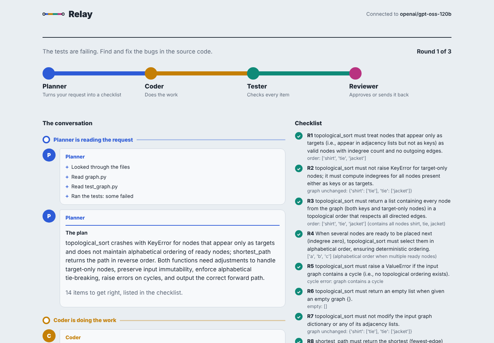

# Agent Orchestrator

A multi-agent system that fixes bugs in Python projects and creates new work from plain-language
requests. Four AI agents (Planner, Coder, Tester, Reviewer) hand work to each other through
typed submissions, coordinated by a state machine, and measured against a single-agent baseline
on a 15-task benchmark with hidden tests.

**Relay**, the included web app, lets anyone type a request and watch the agents work it out.



## Results

On 15 bug-fixing tasks (3 runs each, same model and code for both modes):

| | Single agent | Team of four |
|---|---|---|
| Easy | 12 / 12 | 12 / 12 |
| Medium | 15 / 15 | 15 / 15 |
| Hard | 14 / 17 (82%) | **17 / 17 (100%)** |
| **All** | **41 / 44 (93%)** | **44 / 44 (100%)** |
| Tokens per task | 11,459 | 47,932 (4.2x) |

The whole difference is one task, where the single agent fixed what the visible tests showed
and missed a rule stated only in a docstring, in every run. The team's Planner turned that
docstring rule into an explicit requirement. The revision loop never fired, and the Tester
failed to submit in 64% of runs, which led to the follow-up changes and the ablation described in
[evals/RESULTS.md](evals/RESULTS.md), which also covers the limitations.

## How it works

```mermaid
flowchart LR
    T[Request] --> P[Planner]
    P -->|requirements| C[Coder]
    C --> G{Project's own tests\n(no model)}
    G -->|fail| C
    G -->|pass| TE[Tester]
    TE -->|a requirement fails| C
    TE -->|all pass| R[Reviewer]
    R -->|blocker issues| C
    R -->|approve| D[Done]
```

- **One agent loop, four configurations.** Each role is the same loop with its own prompt, tool
  set, step limit, and a typed `submit_*` tool validated by pydantic, so roles pass structured
  data instead of prose.
- **Least privilege, enforced twice.** Each role only sees its own tools, and the tool layer
  refuses anything else. Only the Coder can write files; the Tester's scripts run in a
  throwaway copy of the project.
- **Cheap checks first.** A deterministic test run sits between the Coder and the Tester, and
  the Reviewer only runs once every requirement passes.
- **Built to survive free tiers.** Waits on rate limits, stops cleanly at daily limits, keeps
  each request under a size budget, retries malformed tool calls with an explanation, detects
  loops, and enforces per-task token budgets.
- **Observable.** Every agent writes a JSONL trace and every team run saves its full state.

The design and the reasoning behind each decision: [docs/ARCHITECTURE.md](docs/ARCHITECTURE.md).

## Evaluation harness

`evals/` holds 15 tasks (easy to hard) with visible tests, hidden tests that only check
behaviour the docstrings specify, and reference solutions. The harness copies each task to a
temporary folder, runs an agent, restores the original tests (so editing tests cannot pass),
adds the hidden tests, and judges by running pytest itself. Results are saved after every run,
API errors are excluded from scores, and interrupted runs resume with `--retry-errors`.
`--check-tasks` proves every task is broken and solvable without calling the API.
Details: [evals/README.md](evals/README.md).

## Quick start (Windows PowerShell)

```powershell
git clone https://github.com/Muhammad-Aitzaz-Khan/agent-orchestrator.git
cd agent-orchestrator
python -m venv .venv
.venv\Scripts\activate
pip install -e ".[dev]"
copy .env.example .env      # then add your API key (any OpenAI-compatible provider)
python -m orchestrator.doctor
```

Then:

```powershell
python -m orchestrator.web                                   # the Relay web app
python evals/run_evals.py --mode multi --repeats 3           # the benchmark
python -m orchestrator --mode multi --root path\to\project "Fix the failing tests."
```

Relay also plays back recorded runs, so it can be explored without an API key.

### Optional: run model-written code in a container

```powershell
docker build -t orchestrator-sandbox sandbox
```

and set `SANDBOX=docker` in `.env`. Tests and the Tester's scripts then run with no network, a
read-only filesystem apart from the project folder, an unprivileged user, and CPU, memory, and
process limits.

## Project layout

```
src/orchestrator/
    agent.py          the agent loop and its recovery logic
    roles.py          the four roles, for fixing and for creating
    orchestrator.py   the state machine that coordinates them
    tools.py          tools, permissions, and sandboxing
    context.py        keeps requests under a size budget
    doctor.py         checks the provider, key, and model
    web/              the Relay web app (FastAPI, live events, replays)
evals/                benchmark tasks, harness, re-scoring, results
docs/                 architecture notes
tests/                113 tests, none of which call a real API
```

## Limitations

- Benchmark of 15 small tasks; the single agent already scores 93%, so harder tasks are needed
  to measure further improvements.
- The team costs about four times the tokens of a single agent.
- Without `SANDBOX=docker`, model-written code runs as a normal process on your machine.
