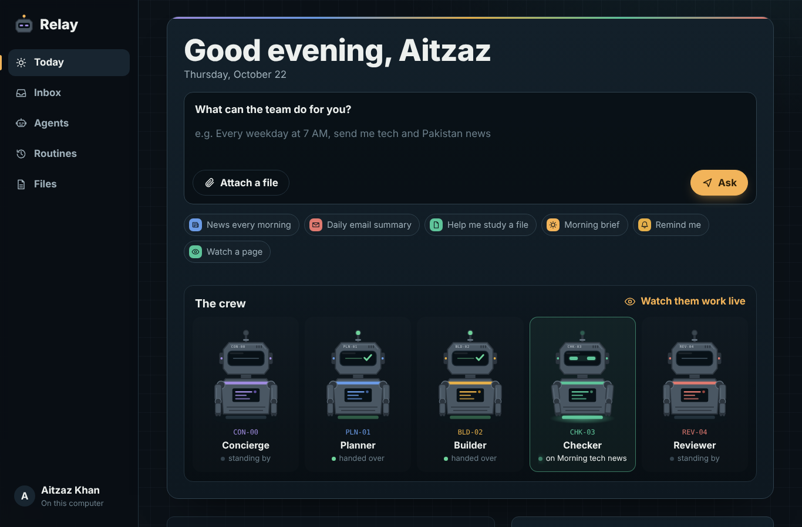
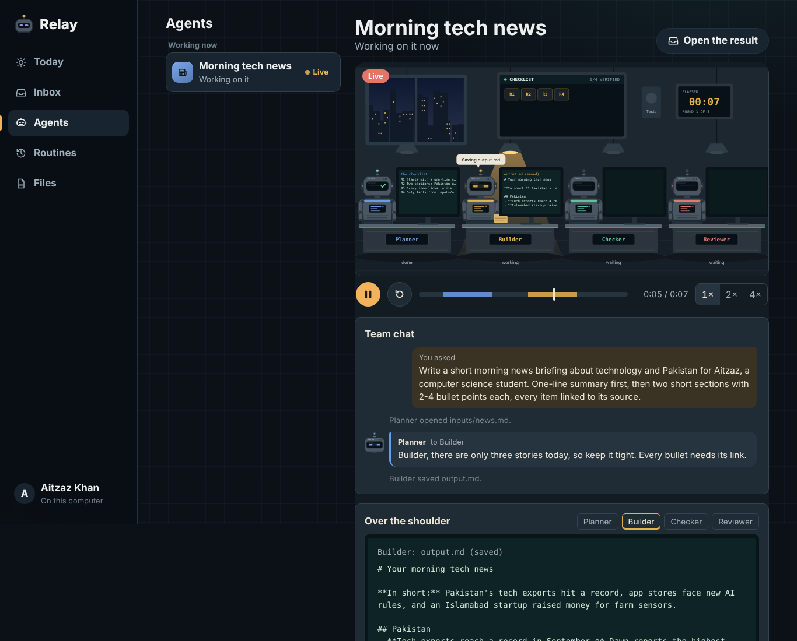
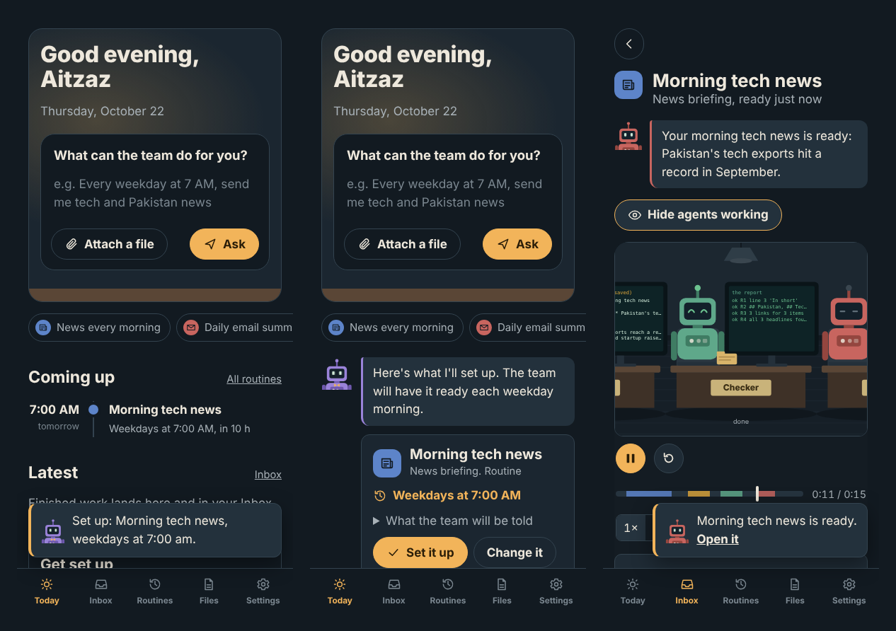
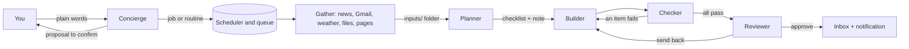

# Relay: a personal assistant run by a team of AI agents

Tell Relay what you need: the news at 7 every morning, a summary of today's email, a file
worked through while you're out. A **Concierge** agent turns the request into a job or a
routine and shows you exactly what it understood. Then a team of four agents (Planner,
Builder, Checker, Reviewer) does the work in the background, and you get a notification when
it's ready. The **Agents** page (or **Show agents working** on any result) opens the office,
where you can watch each robot's screen, live.

<p align="center"></p>



## What you can hand over

| | |
|---|---|
| **News briefings** on your topics, every morning or whenever you like | **Email summaries** (Gmail, read-only): what needs a reply, what can wait |
| **Work on a file**: summaries, flashcards, quizzes, translations | **Reminders** in your own words, once or on repeat |
| **Morning brief**: weather, calendar, headlines, and new email on one page | **Page watcher**: speaks up only when a page changes |
| **Research reports** with sources | **Weekly planner** from your goals and calendar |
| **Deadline finder** across email and files | **Reply drafts** (drafts only; nothing is ever sent) |
| **Weather heads-up** only when tomorrow needs an umbrella | **Anything else** you'd ask a capable assistant to write or plan |

## Watch the agents work

The crew on Today lights up with what each robot is doing right now. The **Agents** page shows
the office: the job running now (live), recent jobs (every job keeps a recording), or example
recordings. The robot holding the job's folder has its lamp on, its mini screen shows what it
is actually doing, the checklist display turns green as the Checker verifies each item, and the
team chat shows the notes the robots leave each other, in their own words.




## On your phone

Relay installs to the home screen and sends notifications, so you don't need to keep it open.



## How it works



- **Review before anything runs.** The Concierge proposes; nothing is scheduled until you tap
  **Set it up**. Routines store a self-contained instruction, because a 7 AM run has no memory
  of the chat that created it.
- **Gather first, then reason.** Ordinary code collects each job's material (Google News RSS,
  Gmail, Open-Meteo weather, uploaded files, web pages) into `inputs/`. The agents never get
  network or mailbox tools, so an email or a web page that says "ignore your instructions"
  cannot make them fetch or send anything. They are also told to treat it as data.
- **Checked against the sources.** The Checker looks up every fact in `inputs/` and fails
  anything it can't find, so briefings don't invent headlines.
- **One agent loop, five configurations.** Every robot is the same loop with its own prompt,
  tools, and a typed `submit_*` tool validated by pydantic; each hand-off carries structured
  data plus a short note to the next robot, which becomes part of that robot's instructions.
- **Built for free tiers.** One job at a time, daily token allowances per person and per site,
  rate-limit waits, and clean stops at the provider's daily limit.

Design notes: [docs/ARCHITECTURE.md](docs/ARCHITECTURE.md). Research behind the design,
including the UI books and patterns it applies: [docs/RESEARCH.md](docs/RESEARCH.md).

## Privacy and safety

- Gmail and Calendar are **read-only**; Relay can't send, delete, or change anything.
- Email is read when a job runs and **not stored**; Google tokens are **encrypted**.
- Only people you invite can sign in (an invite code each, or Google for listed emails), and
  repeated wrong codes are blocked.
- Model-written code runs in a **guarded sandbox** (Python audit hooks block network access,
  other programs, native libraries, and the app's files; a zero process limit stops forks), or
  in a Docker container with `SANDBOX=docker`.
- Every state-changing request needs a same-site header, sessions are signed, and fetched pages
  must be public addresses (no localhost or private networks).

## Does a team beat one agent?

Before the assistant, the team was measured on 15 bug-fixing tasks with hidden tests, 3 runs
each, with the same model (`gpt-oss-120b`) and code for both modes.


| | One agent | Team of four |
|---|---|---|
| Passed | 41 / 44 (93%) | **44 / 44 (100%)** |
| Tokens per task | 11,459 | 47,932 (4.2x) |

The whole difference was one task, where the single agent missed a rule written only in a
docstring and the Planner wrote it down as a requirement. The revision loop never fired, and
the Tester often ran out of steps. Full analysis: [evals/RESULTS.md](evals/RESULTS.md).


## Run it

On your own computer, with an API key for any OpenAI-compatible provider (Groq has a free tier):

```powershell
git clone https://github.com/Muhammad-Aitzaz-Khan/agent-orchestrator.git
cd agent-orchestrator
python -m venv .venv
.venv\Scripts\activate
pip install -e ".[dev]"
copy .env.example .env      # add your key
python -m orchestrator.doctor
python -m orchestrator.web  # opens Relay in your browser
```

Locally, Relay signs you in automatically and keeps its data in `relay.db`. Gmail and Calendar
need Google credentials (see the guide below). Recorded jobs can be watched at `/demo`.

To put it online for free, for you and the people you invite, with routines that run while your
computer is off: make three free accounts (Render, Groq, Neon), then run
`python deploy\deploy.py`. It creates the Render service from this repository, stores the
secrets, makes an invite code for each person, and keeps the site awake for scheduled routines. Details:
[docs/DEPLOY.md](docs/DEPLOY.md).

Other entry points:

```powershell
python evals/run_evals.py --mode multi --repeats 3     # the benchmark (also: single, plan-code)
python -m orchestrator --mode multi --root path\to\project "Fix the failing tests."
```

## Project layout

```
src/orchestrator/
    agent.py          the agent loop and its recovery logic
    roles.py          the team's roles: for fixing, creating, and assistant jobs
    orchestrator.py   the state machine that coordinates them
    assistant/        the Concierge, skills, gathering, scheduler, Google, notifications
    tools.py          tools, permissions, and sandboxes
    guard/            the audit-hook sandbox used on servers without Docker
    web/              the app (one page), the office, sign-in and API, recordings
evals/                benchmark tasks, harness, re-scoring, results
deploy/               one-command deployment to Render
docs/                 architecture, research, deployment
tests/                tests for every part, none of which call a real API
```

## Limitations

- On a free Groq key the whole site gets roughly 5 to 10 team jobs a day.
- While the Google app is in Testing, Gmail and Calendar ask to be reconnected weekly.
- The benchmark has 15 small tasks and one agent already scores 93%; the assistant's own
  quality has not been benchmarked yet.
- The guarded sandbox is defence in depth for a small invite-only site, not a container.
